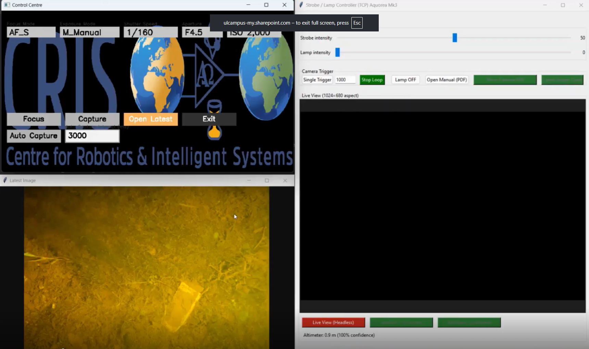

# Aquorea Mk3 — Strobe/Lamp + Camera Control GUI

A Windows-oriented Python/Tkinter application to control an **Aquorea Mk3** strobe/lamp system over TCP, drive a **Sony SDK camera app** (headless or GUI), monitor **Live View**, pop up the **latest captured image**, log **exposure counts** to CSV, pair exposures to **DSC*.JPG** files, and read a **Blue Robotics Ping1D** altimeter (UDP or serial).


---

## Table of contents

- [Highlights](#highlights)
- [Screens & Controls](#screens--controls)
- [Requirements](#requirements)
- [Installation](#installation)
- [Configuration](#configuration)
- [Quick start](#quick-start)
- [How things work](#how-things-work)
  - [TCP (Aquorea/Arduino)](#tcp-aquoreaarduino)
  - [Camera control (Sony SDK)](#camera-control-sony-sdk)
  - [Live View](#live-view)
  - [Latest Image popup](#latest-image-popup)
  - [Exposure logging + image pairing](#exposure-logging--image-pairing)
  - [Altimeter (Ping1D)](#altimeter-ping1d)
- [CSV schema](#csv-schema)
- [Packaging to EXE (PyInstaller)](#packaging-to-exe-pyinstaller)
- [Troubleshooting](#troubleshooting)
- [Notes & credits](#notes--credits)

---

## Highlights

- **Strobe/Lamp control** via TCP commands (intensity 0–100)  
- **Trigger loop** (ms hold & interval) with safety prompts  
- **Sony SDK integration (in-process)**: the GUI loads `SonyCam.dll` and calls the camera directly: connect, capture, live view, store destination, mode/shutter/aperture/ISO/focus  
- **Shot log + image renaming**: every shot the camera saves to its card is logged live (time, seabed altitude, lights, settings) without sending images up the tether; **Rename Card Images...** renames the files after the dive  
- **Live View panel** (frames straight from the camera, no temp files)  
- **Latest Image** window that shows the last image the camera saved  
- Legacy **Show Camera GUI** button still launches `RemoteCli.exe 1` (the OpenCV camera GUI)  
- **Exposure logging** to CSV and **auto-pairing** to images within a time tolerance  
- **Blue Robotics Ping1D** altimeter over **UDP or serial** with confidence readout  
- **Session log file** per run (timestamps, commands, camera stdout)  
- **Open PDF Manual** button (bundles/opens `Aquorea Mk3 Manual.pdf`)  

---

## Screens & Controls

- **Intensities**: two sliders
  - `STROBE_INTENSITY N` (0–100)
  - `LAMP_INTENSITY N` (0–100)
- **Camera Trigger**
  - **Single Trigger** → `TRIGGER`
  - **Start/Stop Loop** → sends `TRIGGER_MS <hold_ms>` every `<interval_ms>`
  - **Lamp OFF** → `LAMP OFF`
  - **Open Manual (PDF)** → opens `Aquorea Mk3 Manual.pdf`
  - **Show Camera GUI** → restarts `RemoteCli.exe 1`
  - **Show Latest Image** → toggles the latest-image viewer
- **Live View row buttons**
  - **Live View (Headless)** → restarts `RemoteCli.exe` with no args
  - **Arduino: Retry Connect** → reconnect TCP client
  - **Altimeter: Retry Connect** → reinit Ping1D
- **Altimeter label**: `Altimeter: <distance> m (<confidence>%)`

---

## Requirements

**OS**
- Windows 10/11 recommended (paths in code use Windows examples)

**Python**
- Python 3.9+ (Tkinter included on Windows Python.org builds)

**Pip packages**
- `Pillow` (image loading/resizing)
- `bluerobotics-ping` (installs `brping` for Ping1D; optional if no altimeter)

```powershell
py -3 -m pip install pillow bluerobotics-ping
```

**External tools & files**
- **Sony SDK camera CLI** you compiled, e.g. `RemoteCli.exe`
- A Live View JPEG produced by your camera CLI (file path is configured)
- `Aquorea Mk3 Manual.pdf` placed next to `main.py` (or bundled when packaging)

---

## Installation

1. **Clone / copy** the project.
2. (Optional) **Create a venv**:
   ```powershell
   py -3 -m venv .venv
   .venv\Scripts\activate
   ```
3. **Install deps**:
   ```powershell
   pip install --upgrade pip
   pip install pillow bluerobotics-ping
   ```
4. **Put your camera exe** (`RemoteCli.exe`) in a known folder.

---

## Configuration

Open `main.py` and review the constants near the top:

```python
DEFAULT_HOST       = "192.168.2.70"
DEFAULT_PORT       = 9000
MANUAL_FILENAME    = "Aquorea Mk3 Manual.pdf"

DEFAULT_IMAGE_DIR  = r"C:\...\Sony_SDK\build\Release"     # Sony output folder
CAMERA_APP_EXE     = r"C:\...\Sony_SDK\build\Release\RemoteCli.exe"
STOP_FILE_PATH     = os.path.join(os.path.dirname(CAMERA_APP_EXE), "stop.txt")

LIVEVIEW_PATH      = r"C:\...\Sony_SDK\build\Release\LiveView000000.JPG"
LIVEVIEW_REFRESH_MS = 50
LIVEVIEW_TARGET_W   = 1024
LIVEVIEW_TARGET_H   = 680

# Ping1D (choose serial OR udp)
PING_CONNECT_MODE = "udp"          # or "serial"
PING_SERIAL_PORT  = "COM3"
PING_SERIAL_BAUD  = 115200
PING_UDP_HOST     = "192.168.2.2"
PING_UDP_PORT     = 9090
PING_REFRESH_MS   = 100

# Image pairing
MATCH_TOLERANCE_SEC = 2.0
IMAGE_PATTERN       = r"^DSC(\d+)\.(jpg)$"   # case-insensitive
```

> **Tip:** The app uses `stop.txt` as a **soft shutdown signal** for your camera exe between restarts.

---

## Quick start

1. **Set paths** in `main.py` for:
   - `DEFAULT_IMAGE_DIR` (where `DSCxxxxx.JPG` appear)
   - `CAMERA_APP_EXE` (your compiled Sony CLI)
   - `LIVEVIEW_PATH` (the live view JPEG file)
2. Ensure **Aquorea/Arduino** is reachable at `DEFAULT_HOST:DEFAULT_PORT` (TCP).
3. (Optional) Connect **Ping1D** (UDP or serial), set the constants.
4. Run:
   ```powershell
   py -3 main.py
   ```
5. The app **auto-starts** the camera app (headless), auto-connects TCP, and starts the altimeter poll.  
6. Use the controls; see log output in `session_log_<timestamp>.txt` created in the working folder.

---

## How things work

### TCP (Aquorea/Arduino)

- The app owns a simple TCP client with a background receive thread.
- Incoming lines are logged; if they carry `EXPOSURE_COUNT <N>`, they feed the **exposure logger**.
- Commands sent (examples):
  - `TRIGGER`
  - `TRIGGER_MS <hold_ms>`
  - `STROBE_INTENSITY <0..100>`
  - `LAMP_INTENSITY <0..100>`
  - `LAMP OFF`
  - Exposure subsystem:
    - `START_EXPOSURE_COUNT`
    - `GET_EXPOSURE_COUNT` (periodic poll while logging)
    - `STOP_EXPOSURE_COUNT`

### Camera control (Sony SDK)

The camera code from the `Sony_SDK` repo is built as a shared library, `SonyCam.dll`
(CMake target `SonyCam`, C API in `app/SonyCamApi.h`). `sony_camera.py` loads it with
`ctypes`, so the GUI calls the camera directly instead of running `RemoteCli.exe` as a
black box.

- **Setup:** build `SonyCam` (see the Sony_SDK README) and copy `SonyCam.dll` into
  `Release/` next to `Cr_Core.dll`, the OpenCV DLLs and `CrAdapter/` (`SONYCAM_LIB_DIR`).
- **Sony Camera panel:**
  - **Connect Camera**: loads the DLL, connects to the first camera and starts live view.
  - **Capture**: fires the shutter from the PC (hardware triggers from the Arduino still work as before).
  - **Save to**: the camera's still image store destination (PC / Camera / PC + Camera).
    **Camera** keeps images on the card so nothing large goes up the ROV tether.
  - **Mode / Shutter / Aperture / ISO / Focus**: read from the camera on connect, and set
    when you pick a value (greyed out when the camera won't allow a change, e.g. the dial
    position decides). **Refresh** re-reads them.
- Everything the camera code logs goes to the session log with a `[SonyCam]` tag.
- **Show Camera GUI** releases the in-process connection and launches `RemoteCli.exe 1`
  (only one program can hold the camera). Press **Connect Camera** to take it back.

### Image naming

**Saving to the camera card (normal for the ROV).** Each time the camera has saved a
shot, it sends a tiny capture event (no image data) and the GUI adds a row to
`shot_log_<session>.csv` in the **Image folder**:
`shot, time, seabed_alt_m, strobe_intensity, lamp_intensity, mode, shutter, aperture, iso, focus`.
The panel shows the running shot count.

After the dive, copy that dive's images off the card into a folder and press
**Rename Card Images...** (pick the folder, then the shot log). It previews the renames and
asks before changing anything. From a terminal:

```
python card_rename.py <image folder> <shot_log.csv> --prefix DIVE01 --dry-run
```

Files are renamed using the shot's PC time and altitude:

```
<prefix>_<YYYYmmdd_HHMMSS_mmm>_alt<seabed alt>m_<camera name>.<ext>
e.g.  DIVE01_20261028_142233_517_alt1.23m_DSC01234.JPG
```

- The camera sends exactly one event per saved shot, so if the folder holds the same
  number of shots as the log they are paired in order. Copy only that dive's images for
  this exact match.
- Otherwise each image's EXIF capture time is lined up with the log (the camera clock does
  not need to match the PC clock). Images that don't line up, such as shots from before the
  session, are left unchanged and listed.
- RAW + JPEG of one shot keep the same new name. Each rename is added to `image_log.csv`.
- The time is when the GUI received the capture event, a fraction of a second after the shot.
- Not reported by ILCE-9M2, ILCE-7RM4, ILME-FX6, MPC-2610, PXW-Z200 or HXR-NX800 (Sony SDK limitation).

**Saving to the PC (PC / PC + Camera).** Images that reach the PC are renamed straight away
in the same format (untick **Rename** to keep the camera's names) and logged to `image_log.csv`.

### Live View

- While connected, a background thread fetches live view JPEGs from `SonyCam.dll` and the
  panel repaints whenever a new frame arrives, resized to a **1024×680 aspect** box.
- While the legacy `RemoteCli.exe` GUI is running, the panel shows its `LIVEVIEW_PATH` file instead.

### Latest Image popup

- Shows the last JPEG the camera saved this session (falls back to the highest-numbered
  `DSCxxxxx.JPG` in the image folder).

### Exposure logging + image pairing

- When you **Start** exposure logging:
  - Creates `exposure_log_<timestamp>.csv` and writes a header.
  - Clears internal queues; snapshots existing `DSC*.JPG` so only **new** files are considered.
  - Starts periodic `GET_EXPOSURE_COUNT` polling and a folder scanner.
- **Pairing logic**:
  - Tracks exposure timestamps from `EXPOSURE_COUNT` messages.
  - Tracks new image timestamps from file mtimes.
  - For each exposure, picks the **closest** image within **±`MATCH_TOLERANCE_SEC`** (default 2.0 s).
  - Writes a row to CSV and logs a `[PAIR]` line with the delta in ms.

### Altimeter (Ping1D)

- Optional, uses `brping.Ping1D`:
  - **UDP**: `connect_udp(PING_UDP_HOST, PING_UDP_PORT)`
  - **Serial**: `connect_serial(PING_SERIAL_PORT, PING_SERIAL_BAUD)`
- After `initialize()`, polls every `PING_REFRESH_MS` ms and shows:
  - `Altimeter: <distance_m> m (<confidence>%)`
- Button reflects state (green when reading OK).  
- If `brping` isn’t installed, the label suggests: `pip install bluerobotics-ping`.

---

## Packaging to EXE (PyInstaller)

A minimal one-file, windowed build that bundles the PDF:

```powershell
pyinstaller --onefile --windowed --name CRIS_Sony_ILX_Interface --icon "app.ico" --add-data="app.ico:." --add-data="StrobeCameraManual.pdf:." main.py
```

> The code uses a `resource_path()` helper for PyInstaller (`sys._MEIPASS`) so bundled files (e.g., the manual) resolve correctly.

`SonyCam.dll` and the Sony SDK runtime are not bundled into the exe: keep them in a
`Release/` folder next to `CRIS_Sony_ILX_Interface.exe` (as for `RemoteCli.exe`).

---

## Troubleshooting

**Connect Camera fails**
- `SonyCam.dll not found`: build the `SonyCam` target and copy it into `Release/`.
- `API version ... does not match`: rebuild `SonyCam.dll` from the matching Sony_SDK branch.
- `no camera found`: camera powered on, USB connected, and not held by another program
  (close `RemoteCli.exe` / Imaging Edge).
- Check the session log for `[SonyCam]` lines.

**Shot count stays at 0**
- The capture event needs a connected camera (**Connect Camera**) and a model that reports it (see Image naming).

**Rename Card Images leaves files unmatched**
- Make sure the shot log is from the same dive, and copy only that dive's images.
- JPEGs are matched by their EXIF time; RAW files follow the JPEG with the same name.

**Altimeter stuck on “no data”**
- Verify connection mode and COM/IP.
- For serial, check the port and baud. For UDP, confirm host/port reachability.
- Reinstall: `pip install --force-reinstall bluerobotics-ping`.

**Camera app won’t (re)start**
- Verify `CAMERA_APP_EXE` path.
- The app writes `stop.txt` next to the EXE—ensure your EXE watches for it and exits.

**TCP connect fails**
- Confirm Aquorea/Arduino IP/port and network.
- Only one TCP client should connect at a time.

---

## Measuring throughput

- iperf3 -c 192.168.2.2 -t 90 -R

## Notes & credits

- **Blue Robotics Ping1D** via `brping` (installed by `bluerobotics-ping`).
- **Pillow** for image IO & resizing.
- **Tkinter** for GUI.

## 👤 Author

Luke Griffin
CRIS
University of Limerick
